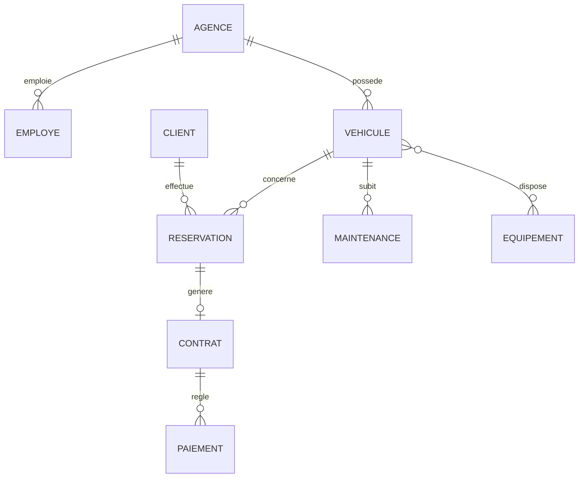

# bensassiadel4ssa15

Application de gestion de parc automobile (location de véhicules) développée avec **Spring Boot 4**, **Spring Data JPA** et **MySQL**.

Projet réalisé dans le cadre du module **4SSA15** à **ESPRIT**.


---

## Sommaire

- [Fonctionnalités](#fonctionnalités)
- [Stack technique](#stack-technique)
- [Structure du projet](#structure-du-projet)
- [Modèle de données](#modèle-de-données)
- [Repositories](#repositories)
- [Configuration](#configuration)
- [Lancement](#lancement)
- [API](#api)
- [Auteur](#auteur)

---

## Fonctionnalités

Le domaine couvre la gestion d'une agence de location de véhicules :

- **Agences** : plusieurs agences, chacune avec ses employés et son parc de véhicules
- **Véhicules** : immatriculation, marque, modèle, catégorie, tarif journalier et statut
- **Clients** : informations personnelles et numéro de permis
- **Réservations** : période de location, véhicule et client associés, statut
- **Contrats** : générés à partir d'une réservation, avec un montant total et un état de validité
- **Paiements** : rattachés à un contrat (montant, date, mode de paiement)
- **Maintenances** : historique des interventions par véhicule
- **Équipements** : équipements pouvant être associés à plusieurs véhicules

## Stack technique

| Composant | Version / Technologie |
|-----------|----------------------|
| Langage | Java 17 (+ Kotlin pour certains enums) |
| Framework | Spring Boot 4.0.8 |
| Persistance | Spring Data JPA / Hibernate |
| Base de données | MySQL (`mysql-connector-j`) |
| Build | Maven (wrapper inclus) |
| Outils | Lombok (getters/setters), springdoc-openapi (Swagger UI) |

## Structure du projet

```
src/main/java/esprit/tn/bensassiadel4ssa15
├── Bensassiadel4ssa15Application.java
├── domain
│   └── services          # Couche métier (services)
├── model
│   ├── entities          # Entités JPA
│   ├── enums             # Énumérations métier
│   └── repositories      # Interfaces Spring Data JPA
└── webController         # Contrôleurs REST
```

Entités : `Agence`, `Client`, `Contrat`, `Employe`, `Equipement`, `Maintenance`, `Paiement`, `Reservation`, `Vehicule`.

Énumérations : `Categorievehicule`, `ModePaiement`, `RoleEmploye`, `StatutReservation`, `Statutvehicule` (Kotlin).

## Modèle de données



| Relation | Cardinalité |
|----------|-------------|
| `Agence` → `Employe` | 1..* (`@OneToMany` / `@ManyToOne`) |
| `Agence` → `Vehicule` | 1..* (`@OneToMany` / `@ManyToOne`) |
| `Client` → `Reservation` | 1..* (`@OneToMany` / `@ManyToOne`) |
| `Vehicule` → `Reservation` | 1..* (`@ManyToOne`) |
| `Vehicule` → `Maintenance` | 1..* (`@ManyToOne`) |
| `Vehicule` ↔ `Equipement` | *..* (`@ManyToMany`) |
| `Reservation` → `Contrat` | 1..1 (`@OneToOne`) |
| `Contrat` → `Paiement` | 1..* (`@OneToMany`, cascade + orphanRemoval) |

## Repositories

Toutes les interfaces étendent `JpaRepository<Entity, Long>` :

| Repository | Entité |
|------------|--------|
| `IAgenceRepository` | `Agence` |
| `IClientRepository` | `Client` |
| `IContratRepository` | `Contrat` |
| `IEmployeRepository` | `Employe` |
| `IEquipementRepository` | `Equipement` |
| `IMaintenanceRepository` | `Maintenance` |
| `IPaiementRepository` | `Paiement` |
| `IVehiculeRepository` | `Vehicule` |

## Configuration

La configuration se trouve dans `src/main/resources/application.properties` :

```properties
spring.application.name=bensassiadel4ssa15
spring.datasource.url=jdbc:mysql://localhost:3306/autoloc_db?createDatabaseIfNotExist=true
spring.datasource.username=root
spring.datasource.password=
server.port=8805
spring.jpa.hibernate.ddl-auto=update
spring.jpa.show-sql=true
```

Prérequis :

- **JDK 17+**
- **MySQL** démarré sur `localhost:3306` (la base `autoloc_db` est créée automatiquement)
- Adapter `spring.datasource.username` / `spring.datasource.password` à votre installation

## Lancement

```bash
# Windows
mvnw.cmd spring-boot:run

# macOS / Linux
./mvnw spring-boot:run
```

L'application démarre sur **http://localhost:8805**.

## API

| Méthode | URL | Description |
|---------|-----|-------------|
| `GET` | `/hello` | Endpoint de test — retourne `Hello World!` |

```bash
curl http://localhost:8805/hello
```

### Documentation Swagger / OpenAPI

La documentation est générée automatiquement par **springdoc-openapi** :

| Ressource | URL |
|-----------|-----|
| Swagger UI | http://localhost:8805/swagger-ui.html |
| OpenAPI JSON | http://localhost:8805/v3/api-docs |
| OpenAPI YAML | http://localhost:8805/v3/api-docs.yaml |

La configuration globale (titre, version, contact, serveur) se trouve dans
`src/main/java/esprit/tn/bensassiadel4ssa15/config/OpenApiConfig.java`.

Pour documenter un endpoint, utilisez les annotations `@Operation` et `@ApiResponse` ;
pour regrouper des endpoints, utilisez `@Tag` sur le contrôleur :

```java
@RestController
@Tag(name = "Véhicule", description = "Gestion des véhicules")
public class VehiculeRestController {

    @Operation(summary = "Endpoint de test")
    @ApiResponse(responseCode = "200", description = "Message retourné avec succès")
    @GetMapping("/hello")
    public ResponseEntity<String> helloWorld() {
        return ResponseEntity.ok("Hello World!");
    }
}
```

> Les contrôleurs REST des autres entités seront ajoutés progressivement.

## Auteur

**Adel Bensassi** — ESPRIT 4SSA15
